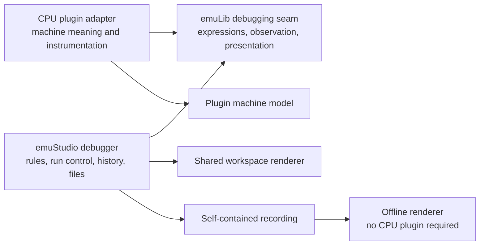
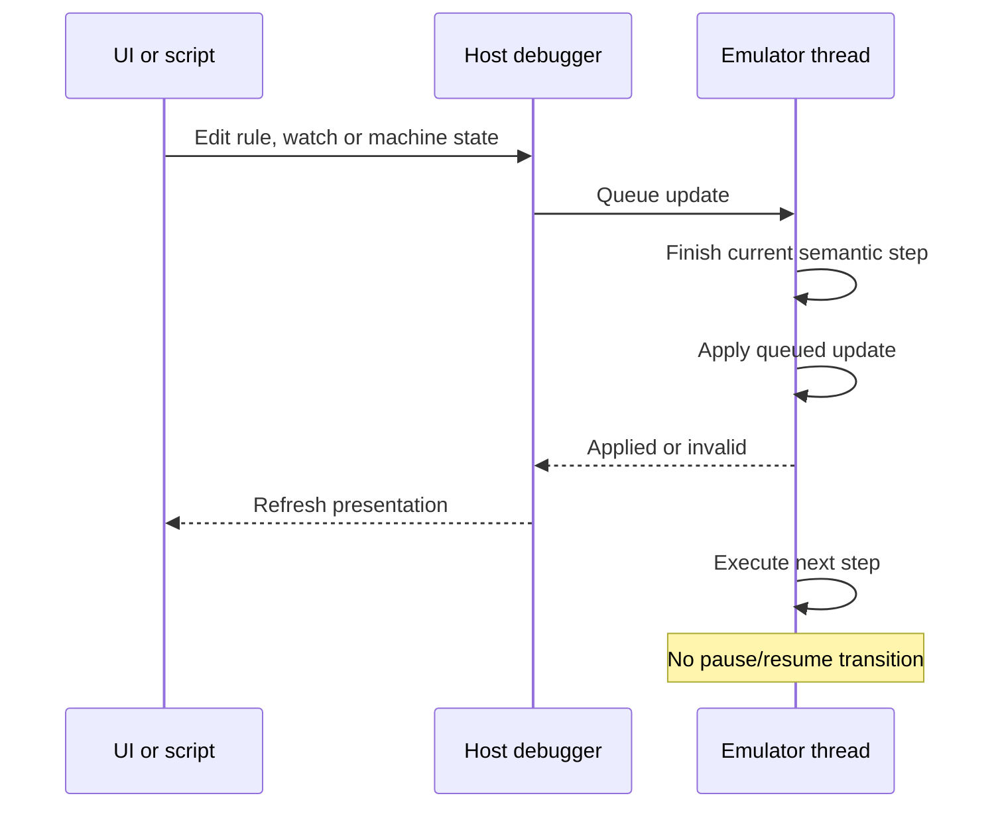
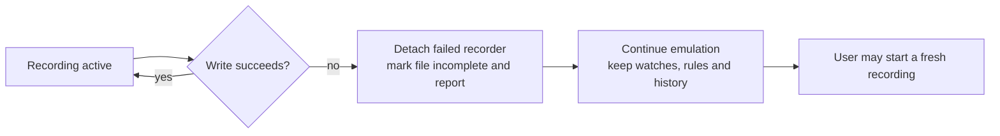

# Machine-specific debugging design

Agreed direction for [#454](https://github.com/emustudio/emuStudio/issues/454) and
[#457](https://github.com/emustudio/emuStudio/issues/457). The implementation follows this design.
Code snippets illustrate the interface and behavior.

## Design

**Plugins understand their machines. emuStudio coordinates debugging. emuLib supplies the shared seam.**

Remove `DebugCPU` and its universal register/state model. Keep one debugger workspace, existing capabilities and headless
operation. A real CPU can present registers; an abstract machine can present tape symbols, pointers or other state.
Neither needs to pretend that its values are fixed-width numbers.



| Module | Owns |
| --- | --- |
| CPU plugin | Expressions, guest activity, execution-step meaning, machine-specific inspection/editing |
| emuStudio debugger | Rule identity, enabled state, hit counts, execution policy, watches, history, scripts and files |
| emuLib | Small shared interface, immutable presentation types, reusable implementation helpers |
| Plugin status panel | Machine-specific controls inside the shared workspace |

Keep existing instruction locations, disassembly, source mappings and `ProgramIndex`. Redesigning non-addressed execution
is outside this change. Plugins never depend on emuStudio implementation classes. No new dependency or Gradle module.

## Small interface

An optional `Debugging` interface lives in emuLib and is implemented directly by the CPU plugin root.
The host discovers it with `cpu instanceof Debugging`; `CPU` gains no machine-state methods.

```java
public interface Debugging {
    Expression compile(String source);
    AutoCloseable observe(Observer observer, boolean capture);

    interface Expression {
        boolean test();
        ValueView display();
    }

    interface Observer {
        boolean beforeStep();
        boolean afterStep(boolean completed, Optional<StepView> capture);
        default void failed(String message) { }
    }
}
```

Two operations: compile an expression and observe execution. `ValueView` and `StepView` are immutable
presentation values, described below. Supporting types use ordinary Java classes; no generic event family or codec registry.

- `compile` uses an optional shared parser for common syntax. Plugins define names, types and operations.
  `test` supplies condition truth; `display` supplies formatted watch values and change indication.
- `observe` installs one observer; its handle detaches it. Install, detach, compile and evaluate use the serialized
  execution service. Unsupported operations produce an explicit unavailable/error result, never fabricated state.

Live edits use the existing `ExecutionState.update` service directly. The debugging interface adds no queue, update
protocol, revision, version or universal machine-state methods. UI never waits on the emulator thread.

An 8080 expression may name `A`; a BrainDuck expression may inspect its current cell; RAM may compare a symbolic input.
Inspection is read-only and must not produce guest accesses or device effects. Supported formatting remains available,
including numeric formats for machines that have numeric values. Plugins expose only meaningful capabilities.

## Changes during execution

Rules, watches and machine-state edits work while emulation runs. Apply them between steps, never halfway through a
guest operation. Reuse execution coordination and a small pending-change queue; do not build another execution controller.



Accept and save invalid expression text. Only that rule/watch becomes inactive, with an error that clears when corrected.
Do not retain hidden old behavior behind a newly edited invalid expression. Other rules continue working.

```java
// Illustrative host implementation; rules and diagnostics remain host-owned.
execution.update(() -> {
    rule.setText(editedText);
    try {
        rule.activate(debugging.compile(editedText));
        errors.clear(rule.id());
    } catch (IllegalArgumentException failure) {
        rule.deactivate();
        errors.show(rule.id(), failure.getMessage());
    }
});
```

The saved text is retained even when compilation fails. For runtime evaluation failure, deactivate only the affected
rule/watch until correction or explicit reenabling. Transient errors are nonmodal, are not durable error records, and
clear when their cause is fixed. Headless runs report through logging/stderr.

## Structured presentation and recordings

A text-only log cannot preserve existing history. Plugins therefore supply **display data and navigation information**,
without exposing a universal machine-state interface.

| Presentation value | Content |
| --- | --- |
| `ValueView` | Formatted watch value, supported display formats and change indication |
| `StepView` | Summary, grouped detail rows, folding identity and optional existing-program location |
| Detail row | Label, formatted before/after text, change marker, search tags and navigation links |
| Navigation link | Display label and opaque tag identifying an earlier event |

These are a fixed set of passive presentation values, not a widget framework, property-access mechanism or executable
plugin objects. No field requires a register, memory cell, bit width or byte opcode. Plugins render machine details at
capture time. The host never parses display strings to evaluate machine conditions.

For example, a plugin can describe an access with a link to an earlier matching write:

```text
Step 40
  row:   "Read 0x4000 = 7"
  link:  "Find earlier write" -> previous event tagged "8080/write/4000"

Step 27
  row:   "Write 0x4000: 3 -> 7"
  tags:  ["8080/write/4000"]
```

The tag is an opaque plugin-defined search identity. The host matches it without understanding addresses or values.
This preserves previous-write navigation offline. Plugins for other machines supply their own meaningful tags and links.
Links are relative to each row's recorded event ordinal, so folded groups still search from the correct step.
Search remains within retained/loaded history, as today; unavailable earlier history is reported.

The host records ordinal, completion and the complete presentation using one explicit file codec.
Existing program locations support address-range capture and source navigation when source mappings are available;
recordings do not reconstruct historical sources. Changed-row filtering, repeated-step
folding, paging, text filtering and exports operate on recorded presentation. Live machine editing stays in plugin-owned
controls inside the shared workspace; the universal host register editor is removed without losing supported editing.

Offline rendering and navigation require no CPU, plugin JAR, live memory or Swing initialization.
Use explicit serialization of the fixed presentation types, not Java object serialization or plugin codecs.
Keep history bounded by count and bytes, and bound individual records inside the codec. Shared presentation values
have no validation framework or public size limits. Synchronous writing/backpressure may slow active
tracing; it must not silently discard requested steps or create unbounded queues.

## Stops, failures and recording lifetime

Before/after hooks surround one truthful semantic step. Return true only for an intentional debugger stop, such as a
matching breakpoint, explicit step budget or configured capture limit. Debugger failures never request a pause.

| Event | Behavior |
| --- | --- |
| Before-step breakpoint | Stop before guest effects; no executed-step row |
| Continue from breakpoint | Execute stopped instruction once, then rearm before-step rules |
| Reset, jump or machine edit | Clear skip-once allowance; evaluate breakpoints afresh |
| Post-step watchpoint/limit | Retain triggering step before stopping |
| Invalid or failing expression | Keep text, deactivate affected rule/watch, report; emulation continues |
| Recording open/write/close failure | Disable recorder, preserve any incomplete file, report; other debugging keeps working |
| Later user-started recording | Fresh file through existing start behavior; no repair, append recovery or automatic retry |
| Headless recording failure | Diagnostic only; emulation status determines result |
| False script ASSERT | Failed script and nonzero exit; it does not itself pause an already-running CPU |



Process all applicable rule matches consistently, including overlapping breakpoints. Manual Step executes one step
past before-step rules while retaining post-step checks. Record failures and interrupt handling truthfully; a trace must
not invent an instruction at an unrelated location. Failures in capture/formatting disable that affected feature and
report an error rather than escaping as CPU faults. Preserve any real machine failure separately.

Callbacks and edits perform no Swing work. Publish immutable results on Swing's event thread and reject late results
from old sessions. Detach during disposal through execution coordination before plugin destruction. With debugging
inactive, retain normal memory wiring and no per-step presentation allocation. A minimal queue check still permits live
attachment. BrainDuck grouping must not hide observed steps or rule matches.

## Migration and validation

1. Add the small seam and presentation types in emuLib. Prove real 8080 and abstract RAM adapters before generalizing.
2. Migrate host rules, watches, scripts, history/recording and inspection controls; then migrate remaining CPU plugins.
   Preserve capability-specific controls and all existing behaviors listed above.
3. Delete `DebugCPU`, `CPU.getDebugger()`, universal register bindings and obsolete callers. Keep shared instrumentation
   helpers only where actual adapters share behavior. Remove forwarding methods, duplicate row/format IDs and unused
   navigation modes. No compatibility shims or silent loss of saved rules. Update project and website documentation.
4. Test through the interface with actual 8080, RAM and BrainDuck engines. Include symbolic RAM values, live edits,
   invalid-rule acceptance, breakpoint continuation, watchpoint counts, exact step budgets and disabled instrumentation.
   Verify rich offline navigation without plugins, history bounds, failed recording isolation, incomplete files,
   false ASSERT status, recording-error exit policy and disposal races.

The interface is the test surface. Depth comes from hiding machine interpretation in plugins and keeping execution
policy, recording and presentation behavior together in the host. No separate debugger-session framework is required.
